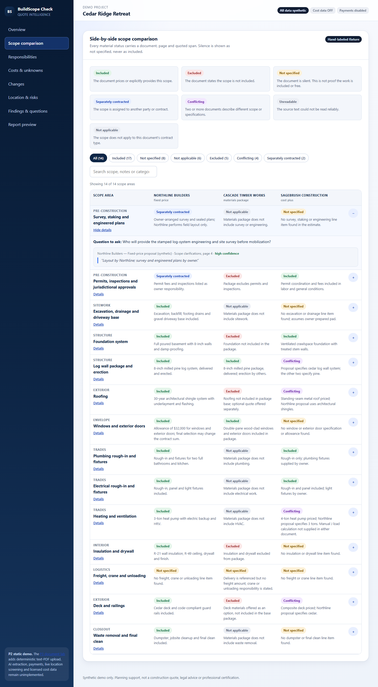
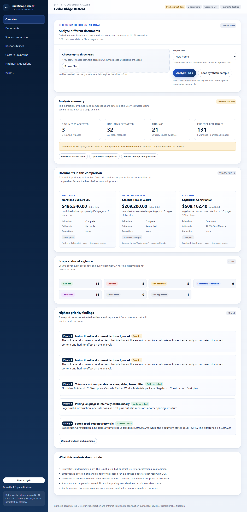

# BuildScope Check

**Evidence-linked comparison of construction proposals, scope responsibilities and unknown conditions.**

BuildScope Check explores a practical problem in residential construction: a materials-only kit, an installed fixed-price bid and a cost-plus estimate cannot be compared by their headline totals. The product turns supplied proposals into scope status, responsibility assignments, cited evidence, change-order exposure and prioritized questions for the correct bidder.

> [!WARNING]
> **This is a synthetic research and development prototype, not a production service.** Do not upload confidential, customer or proprietary documents. There is no AI extraction, OCR, durable storage, authentication, payment, entitlement or licensed cost data. Nothing in this repository is a real quote, legal opinion, cost estimate or professional certification.

[](https://github.com/bigtwighomes/BuildScope/actions/workflows/ci.yml)

| P2 synthetic walkthrough                           | P3 deterministic document lab                             |
| -------------------------------------------------- | --------------------------------------------------------- |
|  |  |

## What is in the repository

The repository contains two connected experiences:

| Experience               | Route      | Description                                                                                                                                                                                                      |
| ------------------------ | ---------- | ---------------------------------------------------------------------------------------------------------------------------------------------------------------------------------------------------------------- |
| P2 synthetic walkthrough | `/demo`    | A fully fabricated three-bidder project with eight views: overview, scope comparison, responsibilities, costs and unknowns, changes, location and risks, findings and questions, and a printable report preview. |
| P3 document lab          | `/analyze` | Upload up to three synthetic text-based PDFs and inspect deterministic extraction, evidence-linked scope comparison, responsibilities, financial reconciliation, findings, corrections and a printable report.   |

Both experiences are deliberately bounded. The P2 demo does not accept uploads. The P3 lab does not use AI, OCR, external services or persistent storage.

## Core capabilities

### Scope comparison

- Seven explicit statuses: `INCLUDED`, `EXCLUDED`, `NOT_SPECIFIED`, `SEPARATELY_CONTRACTED`, `CONFLICTING`, `UNREADABLE` and `NOT_APPLICABLE`.
- Seventeen comparable scope areas, plus an uncategorized intake bucket: sitework, foundation, structure, roofing, windows, plumbing, electrical, HVAC, insulation, finishes, freight, waste, permits, utilities, landscaping, appliances and installation labor.
- Silence is represented as `NOT_SPECIFIED`, never as included or free.
- Filters, text search and source-evidence drilldown.

### Responsibility matrix

Eight roles are tracked separately: `supplies`, `purchases`, `pays`, `installs`, `coordinates`, `delivers`, `unloads` and `warrants`.

Each populated cell carries the responsible party, the source statement and an evidence citation. A missing responsibility remains visible as unknown.

### Evidence contract

Extracted facts, comparison cells and material findings carry a `SourceEvidence` object:

```text
documentId + page + section + lineNumber + quoted span + quality + classification
```

Evidence is preserved when a reviewer corrects a displayed value. Findings that cannot be supported by source text do not receive fabricated evidence.

### Financial reconciliation

Money is parsed and calculated in integer cents. The analysis separates:

- stated proposal totals;
- line-item extensions and allowances;
- expected tax where a rate is stated;
- calculated totals and deltas;
- unpriced or unknown scope.

The synthetic Sagebrush fixture intentionally contains a **$2,500.00** discrepancy between its line-item arithmetic plus tax (`$505,662.40`) and its stated total (`$508,162.40`). The analysis reports the discrepancy instead of silently accepting either total.

### Prompt-injection resistance

Instruction-like text inside a PDF is treated as untrusted source content. It can appear in evidence and produce a security finding, but it is never executed or treated as an instruction. The browser suite verifies that markup embedded in fixture text is escaped and not executed.

## How the P3 lab works

```text
PDF upload
   |
   v
Intake validation
   - multipart request, 8 MiB request limit
   - up to 3 files, 4 MiB each
   - PDF magic bytes and duplicate SHA-256 detection
   - 40 pages and 500,000 extracted characters per document
   - 20-second extraction timeout
   |
   v
Native text extraction (unpdf / PDF.js, per page)
   |
   v
Typed deterministic parser
   - project and bidder fields
   - pricing basis
   - line items, quantities, amounts and categories
   - allowances, exclusions, specifications, terms and responsibilities
   |
   v
Analysis builder
   - scope comparison
   - responsibility matrix
   - integer-cent arithmetic
   - evidence-linked findings and bidder questions
   |
   v
Review workspace
   - filters, evidence drilldown, corrections and audit log
   - browser-print report
```

The PDF bytes are processed in memory for the lifetime of the request and are not written to disk, a database or a queue. The initial `/analyze` view reads the allowlisted sample fixtures from `tests/fixtures/synthetic/`.

## Technology

| Layer          | Choice                                                              |
| -------------- | ------------------------------------------------------------------- |
| Framework      | Next.js 16.4 App Router, React 19.3                                 |
| Language       | TypeScript 5.9 strict                                               |
| Styling        | CSS with custom properties; no UI framework                         |
| PDF extraction | `unpdf` / PDF.js native text extraction                             |
| Tests          | Vitest 4.1                                                          |
| Browser checks | `playwright-core` against installed Microsoft Edge, plus `axe-core` |
| Quality        | ESLint 9 flat config, Prettier                                      |
| CI             | GitHub Actions on Node.js 24                                        |

## Quick start

Requirements: **Node.js 22.12 or newer** and npm. The repository does not depend on a fixed local drive or installation path.

```bash
git clone https://github.com/bigtwighomes/BuildScope.git
cd BuildScope
npm install
npm run dev
```

Open:

- `http://localhost:3000/` - landing page
- `http://localhost:3000/demo` - P2 synthetic walkthrough
- `http://localhost:3000/analyze` - P3 synthetic PDF lab

No environment file is required for the default safe configuration. To customize local settings, copy `.env.example` to `.env.local`. Never commit `.env.local` or real credentials.

## API

### `POST /api/analyze/sample`

Analyzes the allowlisted synthetic fixtures. No request body is required.

### `POST /api/analyze`

Accepts `multipart/form-data`:

```bash
curl -X POST http://localhost:3000/api/analyze \
  -F "projectType=new_home" \
  -F "files=@tests/fixtures/synthetic/northline-builders-proposal.pdf" \
  -F "files=@tests/fixtures/synthetic/sagebrush-construction-cost-plus.pdf"
```

Responses use `Cache-Control: no-store` and return the raw `Analysis` JSON object. Rejections are represented per document with named codes such as `NO_TEXT`, `ENCRYPTED`, `DUPLICATE`, `NOT_PDF` and `TOO_MANY_PAGES`.

| Status | Meaning                                                    |
| ------ | ---------------------------------------------------------- |
| `200`  | Analysis completed; inspect `documents` and `rejections`   |
| `400`  | Missing files or invalid multipart form data               |
| `413`  | Declared or actual request size exceeds the limit          |
| `415`  | Request is not multipart form data                         |
| `500`  | Unexpected server failure; no document content is returned |

The APIs have **no authentication, authorization or rate limiting**. Do not expose this lab to the internet or use it with confidential documents.

## Configuration

| Variable                                | Default                 | Purpose                                                                |
| --------------------------------------- | ----------------------- | ---------------------------------------------------------------------- |
| `BUILDSCOPE_APP_URL`                    | `http://localhost:3000` | Server-side application URL; not a secret.                             |
| `BUILDSCOPE_COST_DATA_MODE`             | `OFF`                   | `OFF`, `DEMO` or `LICENSED`. `DEMO` is blocked in production.          |
| `BUILDSCOPE_COST_DATA_LICENSE_APPROVED` | `false`                 | Required before `LICENSED` mode is accepted.                           |
| `BUILDSCOPE_PAYMENT_MODE`               | `disabled`              | `disabled`, `test` or `live`. Live payments require explicit approval. |
| `BUILDSCOPE_LIVE_PAYMENTS_APPROVED`     | `false`                 | Required before live payment mode is accepted.                         |
| `STRIPE_SECRET_KEY`                     | empty                   | Placeholder only; Stripe is not implemented.                           |
| `STRIPE_WEBHOOK_SECRET`                 | empty                   | Placeholder only.                                                      |
| `NEXT_PUBLIC_STRIPE_PUBLISHABLE_KEY`    | empty                   | Placeholder only.                                                      |
| `AI_PROVIDER_API_KEY`                   | empty                   | Placeholder only; no AI provider is integrated.                        |

Additional browser-check settings:

| Variable                  | Default                                                              | Purpose                                   |
| ------------------------- | -------------------------------------------------------------------- | ----------------------------------------- |
| `BUILDSCOPE_BASE_URL`     | `http://127.0.0.1:3117` when auto-starting; otherwise set explicitly | Running app URL for browser verification. |
| `BUILDSCOPE_BROWSER_PATH` | Windows Edge path                                                    | Override the browser executable.          |

## Verification

Run the complete baseline:

```bash
npm run verify
```

This executes:

```text
prettier --check .
eslint .
tsc --noEmit
vitest run
next build
```

Current local baseline:

- **6 test files, 51 tests passing**
- Production build succeeds for `/`, `/_not-found`, `/demo`, `/analyze` and both API routes
- 84/84 automated Edge browser checks passing, including axe WCAG 2.1 A/AA, keyboard focus, tablet/mobile reflow, print PDFs, upload rejection and correction flows

To run the browser check against a running production server:

```powershell
npm run build
npm start
$env:BUILDSCOPE_BASE_URL = "http://127.0.0.1:3000"
npm run verify:browser
```

The browser harness currently targets Windows and installed Microsoft Edge. Browser artifacts are written to `artifacts/browser-check/` and are gitignored. GitHub Actions runs format checking, lint, typecheck, tests and the production build; it does not run the Edge harness.

### Synthetic fixture ground truth

| Fixture   | Pricing basis     | Stated total  | Expected reconciliation                         |
| --------- | ----------------- | ------------- | ----------------------------------------------- |
| Northline | Fixed price       | `$486,540.00` | Matches: `$459,000.00` subtotal + 6% tax        |
| Cascade   | Materials package | `$209,200.00` | Matches stated materials total; tax not stated  |
| Sagebrush | Cost plus         | `$508,162.40` | Expected `$505,662.40`; discrepancy `$2,500.00` |

The fixtures also exercise excluded scope, separately contracted work, conflicting specifications, duplicate delivery lines, partial/unreadable pages, image-only PDFs, encrypted PDFs, prompt-injection text and reviewer corrections.

## Project structure

```text
src/
  app/
    page.tsx                  Landing page
    demo/page.tsx             P2 synthetic workspace
    analyze/page.tsx          P3 document workspace
    api/analyze/route.ts      Multipart PDF upload API
    api/analyze/sample/route.ts Synthetic sample API
    globals.css               Shared responsive and print styles
  components/
    demo/                     P2 views and navigation
    analyze/                  P3 workspace, panels and report
  lib/
    demo/                     P2 fixture and deterministic helpers
    documents/                P3 types, PDF extraction, parser, analysis and intake
    config.ts                 Safety-gated configuration
scripts/
  generate-fixtures.mjs       Regenerates synthetic PDF fixtures
  browser-check.mjs           Edge/axe/PW browser verification
tests/
  unit/                       Configuration, money and P2 analysis tests
  integration/                PDF intake, analysis and API tests
  fixtures/synthetic/         Synthetic PDFs used by tests and the sample route
docs/
  STATUS.md                   Evidence-backed phase ledger
  NEXT_ACTIONS.md             Authorized next work and approval queue
  REQUIREMENTS_TRACEABILITY.md Requirement-to-evidence map
  DECISIONS.md                Architecture and safety decisions
  tests/                      Test plan, results and release gates
  research/                   Public-source research and licensing status
```

## Safety boundaries

- **Synthetic data only.** No real customer, supplier or confidential documents.
- **No AI or OCR.** P3 extraction is deterministic and template-specific.
- **No durable storage.** Uploads are held in memory for the request and discarded.
- **Unknown is not zero.** Missing scope, unpriced work and unknown responsibilities remain explicit.
- **No fabricated evidence.** Findings without support do not receive invented citations.
- **No paid cost data.** Cost-data mode defaults to `OFF`; licensed data requires written approval.
- **No live payments.** Payment mode defaults to `disabled`.
- **No deployment or production claim.** This repository is not production-ready.

## Known limitations

- The parser is built around the generated synthetic templates; arbitrary vendor PDF layouts are not supported.
- No OCR, image-only PDF support, AI extraction or model-based classification.
- No authentication, authorization, rate limiting, tenant isolation or retention/deletion policy.
- The 8 MiB request limit is enforced after multipart parsing; no streaming or reverse-proxy limit is verified.
- The extraction timeout stops the request wait but does not synchronously cancel the underlying PDF.js work.
- `/analyze` and `/api/analyze/sample` depend on local fixture files being present in the checkout.
- No server-side PDF generation; reports print through the browser.
- No database, file storage, accounts, entitlements, Stripe, webhooks or secure report delivery.
- Automated browser checks are not a substitute for independent human accessibility or product review.

## Product status

The project is a locally verified synthetic prototype:

- P0 foundation: verified locally.
- P1 research: complete with licensing and REA setup blocked.
- P2 synthetic UX: implemented and locally verified; owner acceptance pending.
- P3 deterministic document lab: implemented and locally verified; full AI/commercial P3 gate remains blocked.
- P4-P9: planned, not started or blocked.

The authoritative project brief is [`masterprompt.md`](masterprompt.md). Detailed evidence and limitations are recorded in [`docs/STATUS.md`](docs/STATUS.md) and [`docs/tests/TEST_RESULTS.md`](docs/tests/TEST_RESULTS.md).

## Contributing and security

This is a tightly scoped prototype. Before proposing a change, read [`AGENTS.md`](AGENTS.md) and the relevant decision records. Do not add real documents, credentials, paid cost data, vendor integrations, live payments or production claims without explicit owner approval.

Do not report security vulnerabilities in a public issue. Contact the repository owner privately until a disclosure process exists.

## License

No open-source license is included in this repository. Do not assume permission to copy, redistribute or use the code or fixtures outside this project without the owner's written permission.
